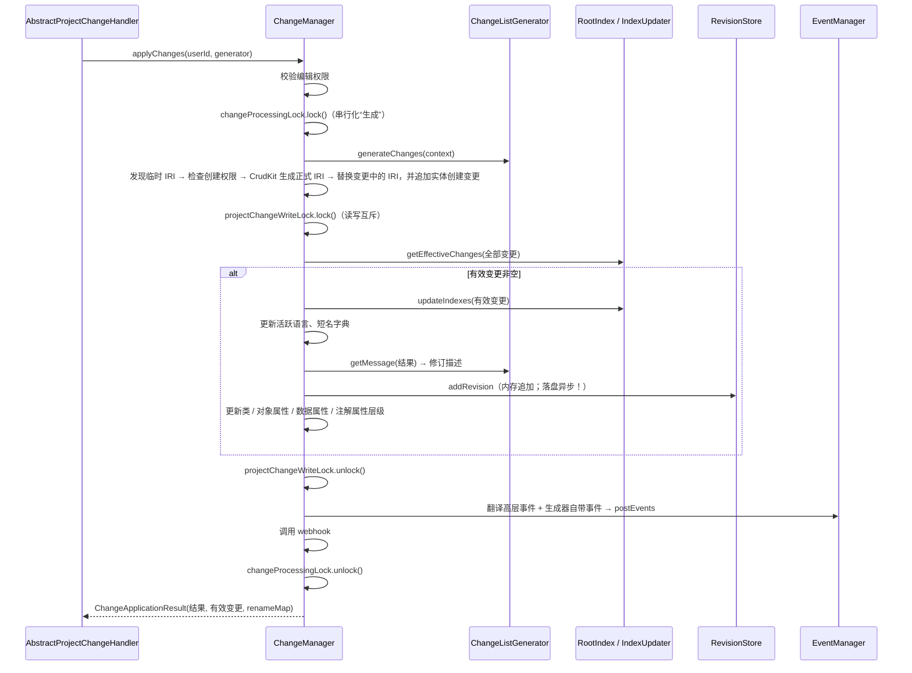
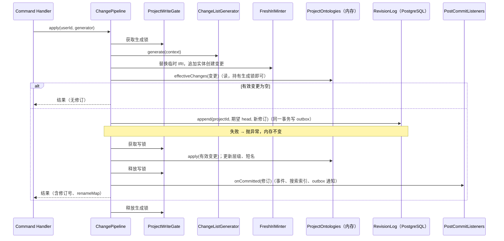

# 写路径：旧系统时序与新系统规格

## 1. 旧系统（逆向结果）

出处：`../webprotege/webprotege-server-core/src/main/java/edu/stanford/bmir/protege/web/server/project/chg/ChangeManager.java`（`applyChanges`，约第 205–345 行；`logAndProcessAppliedChanges`，约第 488–515 行）。

要点：

- **两把锁。** `changeProcessingLock` 让“生成变更”串行，因为生成逻辑依赖当前本体状态；`projectChangeWriteLock`（读写锁的写端）只在“应用”时持有，读请求只在这一段被阻塞。
- **有效变更为空时不产生修订**，也不发事件。
- 生成器若是 `SilentChangeListGenerator`，不发高层事件。
- 结果对象里的临时 IRI 也会按 renameMap 替换（`getRenamedResult`），客户端借此拿到正式 IRI。

## 2. 新系统规格（P1-10、P1-11、P3-02 按此实现）

### 不变量（每条都要有测试）

| 编号 | 不变量 | 测试位置 |
|---|---|---|
| WP-1 | 同一项目任意时刻至多一个生成过程在执行 | P1-10 |
| WP-2 | 持有写锁期间没有读操作在执行；读操作之间可以并发 | P1-10 |
| WP-3 | **先持久化，后更新内存。** `RevisionLog.append` 失败时，内存状态、head 修订号保持不变 | P1-11 |
| WP-4 | 有效变更为空时：不追加修订、不调用 PostCommit 监听器 | P1-11 |
| WP-5 | 修订号从 1 开始，按项目连续递增，没有空洞；并发追加同一个期望 head 时只有一个成功 | P1-08、P3-02 |
| WP-6 | PostCommit 监听器抛异常不影响已提交的修订，也不阻止其它监听器执行；异常会记录日志 | P1-11 |
| WP-7 | 生成器结果中的临时 IRI 全部按 renameMap 替换后再返回 | P1-13 |
| WP-8 | 内存应用阶段抛异常（理论上不应发生）时：把该项目运行时标记为损坏并从缓存驱逐，下次访问从日志重新加载 | P1-11、P3-03 |

### 为什么调整顺序

旧系统先改内存、后异步写盘，存在丢修订的问题（见 `README.md` 第 7 节）。新系统把持久化挪到内存应用之前：

- 有效变更的计算只需要读本体，持有生成锁时没有其它写入者，所以算出的结果在应用时仍然成立；
- 数据库事务提交即视为修订确认，内存应用是确定性的重放，不会失败；万一失败，按 WP-8 处理。
