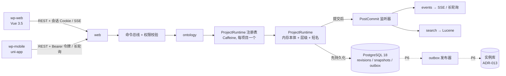

# 目标架构总览

> 修订记录：2026-10-28 初版；2026-10-29 前端改为 Vue，新增 uni-app 移动端，Spring Boot 固定为 4.1.1，PostgreSQL 升级为 18，补充数据放置原则（ADR-013）。

一句话：**一个 Spring Boot 4.1.1 模块化单体 + 一个纯 Java 内核 + 一个独立的旧数据迁移工具 + Vue 3 Web 端 + uni-app 移动端**。编辑器的数据只放在 PostgreSQL 里；运行期的大规模本体实例不进编辑器，见 ADR-013。

## 1. 仓库结构

```
webprotege-rebuild/
  pom.xml                       Maven 父 POM（Java 版本统一管理，见 ADR-002）
  wp-kernel/                    纯 Java：本体变更、修订、编码、运行时、IRI 生成、层级、显示名称
                                依赖：OWL API 5.5.x、SLF4J。禁止依赖 Spring 和 JDBC
  wp-app/                       Spring Boot 4.1.1 应用，按 Spring Modulith 划分应用模块（见第 2 节）
                                依赖：wp-kernel
  wp-legacy-migrator/           独立 CLI：读取旧 BinaryOWL 日志与 mongoexport JSON，输出迁移包
                                依赖：OWL API 4.5.13 + binaryowl 2.0.1。禁止依赖 wp-kernel / wp-app
  package.json                  前端 pnpm 工作区根（只放工作区脚本，不放运行时依赖）
  pnpm-workspace.yaml           成员：wp-web、wp-mobile、packages/*
  packages/api-types/           由 docs/api/openapi.json 生成的 TypeScript 类型，零运行时依赖，Web 与移动端共用
  wp-web/                       Web 端：Vue 3.5 + Vite 8 + TypeScript + Element Plus（ADR-008，P4）
  wp-mobile/                    移动端：uni-app（Vue3 版，内部固定 Vue 3.4 + Vite 5）+ wot-design-uni（ADR-014，P5）
  testdata/                     测试用本体语料（P0-06）
  compose.yaml                  本地 PostgreSQL 18
  tools/                        plan_lint.py（任务卡校验）、task.py（任务流程）、check_ecc.py（ECC 安装检查）
```

- 迁移工具必须独立：它要用 OWL API 4 读取 BinaryOWL，而内核用的是 OWL API 5，两者不能出现在同一个 classpath 上。两边只通过**迁移包文件格式**交换数据（`interchange-format.md`），不共享任何 jar。
- Web 端与移动端必须是两个独立的前端工程：uni-app 固定了自己的 Vue / Vite 版本，与 Web 端的版本不同。两者只共享 `packages/api-types`（纯类型），**不共享 Vue 组件和运行时代码**。

## 2. wp-app 的应用模块（Spring Modulith）

根包：`wprebuild.app`

| 模块（子包） | 职责 | 允许依赖 |
|---|---|---|
| `shared` | 通用异常（NotFound、PermissionDenied、Conflict）、错误码。声明为 OPEN 模块 | — |
| `access` | 用户、登录会话、API Key、移动端访问令牌、角色分配、权限校验（BS-10） | shared |
| `bus` | 命令总线：`Command` / `CommandHandler`、校验链；通过 SPI 接口 `ProjectExistenceCheck` 判断项目状态，不直接依赖 `project` | access, shared |
| `project` | 项目元数据、回收站、项目设置（前缀、CrudKit、显示语言）、共享设置；实现 `ProjectExistenceCheck` | bus, access, shared |
| `revision` | PostgreSQL 实现的 `RevisionLog`、`SnapshotStore`；同一事务写 outbox；修订历史的只读查询接口 | shared |
| `ontology` | `ProjectRuntime` 注册表（Caffeine）；本体命令与查询；导入导出；修订历史与回滚的命令处理器 | bus, project, access, revision, shared |
| `search` | Lucene 实体索引；订阅修订提交事件做增量更新 | bus, ontology, access, shared |
| `events` | 把修订翻译为高层事件（BS-11），通过 SSE 和长轮询推送 | bus, ontology, access, shared |
| `migration` | 导入迁移包，生成带完整历史的项目 | bus, ontology, project, access, shared |
| `web` | REST 控制器、OpenAPI、异常映射、安全配置（含 CORS） | 以上全部 |

- 依赖关系由 `ApplicationModules.of(WpApplication.class).verify()` 测试强制执行（P0-07）。
- `ontology` 写修订时只使用内核里的 `RevisionLog` / `SnapshotStore` 接口，实现由 `revision` 模块作为 Spring Bean 提供；只有查询修订历史时才直接调用 `revision` 模块公开的 `RevisionHistoryQueries`。
- 跨模块的反向通知一律用 Spring 事件：`ontology` 发布 `RevisionCommittedEvent`，`project` 发布 `ProjectSettingsChanged`，`access` 发布 `RoleAssignmentsChanged`。下层模块不引用上层模块的类型。
- 凡是需要操作 `ProjectRuntime` 的命令处理器（创建项目、上传、编辑、回滚等），都放在 `ontology` 模块。

## 3. wp-kernel 的包结构

根包：`wprebuild.kernel`

| 包 | 内容 | 任务卡 |
|---|---|---|
| `id` | `ProjectId`、`RevisionNumber`、`UserId` | P1-01 |
| `change` | `OntologyChange` 密封接口及 7 种实现、`ChangeListMinimiser` | P1-02、P1-03 |
| `ontology` | `ProjectOntologies`（封装 OWL API 5 内存本体）、`EffectiveChanges` | P1-04、P1-05 |
| `codec` | `ChangeCodec`、`OfnLineChangeCodec`、`SnapshotCodec` | P1-06、P1-07 |
| `revision` | `Revision`、`RevisionLog`、`SnapshotStore` 接口及内存实现 | P1-08 |
| `runtime` | `ProjectRuntime`、`ProjectRuntimeLoader`、`ProjectWriteGate`、`ChangePipeline`、`ChangeListGenerator` | P1-09 – P1-11 |
| `iri` | `FreshEntityIri`、`IriReplacer` | P1-12 |
| `crud` | `EntityCrudKit` 及 UUID / Supplied name / OBO 三种实现 | P1-13、P1-14 |
| `generator` | 回滚、删除实体、创建实体、初始导入等通用生成器 | P1-15、P1-16、P1-21 |
| `hierarchy` | 类层级与属性层级 | P1-17、P1-18 |
| `shortform` | 显示名称解析 | P1-19 |

## 4. 运行时视图



## 5. 数据放置（摘要，详见 ADR-013）

| 数据 | 放在哪里 | 说明 |
|---|---|---|
| 本体模型（类、属性、公理、注解，即 TBox） | 编辑器 PostgreSQL：`revisions` + `snapshots` | 修订日志是真源，内存模型是读模型 |
| 设计期实例（枚举值、参考个体、示例个体） | 同上，作为本体中的 OWL 个体 | 每个项目总规模受 P1-20 基准约束 |
| 运行期实例（货位、托盘、批次、任务、设备状态等业务对象） | **不进编辑器**；P6 的实例库（独立的 PostgreSQL 数据库，可选 Apache AGE） | 由系统高频写入，和编辑器的“单写者 + 每次写入一个修订”模型不兼容 |
| 高频时序数据（温湿度、设备遥测） | 现有时序 / 分析库（TDengine、StarRocks 等） | 实例库只存其引用 |

## 6. 与上一版“方案一”的差异

| 项 | 方案一 | 本版 | 依据 |
|---|---|---|---|
| Spring Boot | 3.5 | 4.1.1（固定） | ADR-002 |
| OWL API | 4.5.x（被 BinaryOWL 锁定） | 5.5.x | ADR-003：BinaryOWL 只放进独立迁移工具 |
| 修订存储 | BinaryOWL 文件 + Mongo 元数据 | PostgreSQL 18 单库 | ADR-004 |
| 落盘时机 | 沿用旧系统（异步） | 同步提交后再改内存 | 逆向发现旧系统会丢修订 |
| 内存索引 | 移植 17 个主索引 | 先用 OWL API 自带索引，用基准结果决定 | ADR-005 |
| 冷启动 | 全量重放 | 快照 + 重放尾部 | P1-07、P1-09 |
| 前端 | 未定 | Vue 3.5 Web 端 + uni-app 移动端 | ADR-008、ADR-014 |
| 事件 | 未定 | SSE（Web）+ 长轮询（移动端），以修订号为游标 | ADR-007 |
