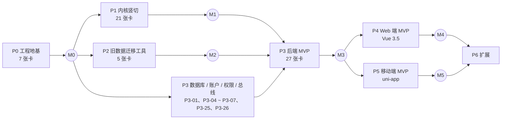

# 阶段路线与里程碑

> 修订记录：2026-10-28 初版；2026-10-29 前端改为 Vue，新增移动端阶段 P5，扩展功能顺延为 P6，新增 P3-26（移动端令牌）与 P3-27（前端工作区与 API 类型包）。

- P1、P2 和 P3 的数据库 / 账户 / 权限部分可以并行，各自只依赖 P0。
- P4（Web 端）与 P5（移动端）在 M3 之后并行，两者只共享 `packages/api-types`（P3-27）。
- 精确的依赖关系与进度：`tasks/INDEX.md` 与 `dependency-graph.md`（由 `plan_lint.py` 生成并纳入 Git）；也可以运行 `python tools/task.py next` 查看主分支上可以开工的卡。

## 里程碑与门禁

| 里程碑 | 达成条件（全部满足） | 门禁检查 |
|---|---|---|
| **M0 地基可用** | P0 全部 `done` | `./mvnw verify` 通过且包含：Spotless、Enforcer（依赖收敛 + 禁用依赖）、Modulith 边界测试、Testcontainers 数据库测试；CI 在 PR 上自动运行并校验分支名与提交信息 |
| **M1 内核竖切** | P1 全部 `done` | `KernelVerticalSliceTest` 通过；P1-20 基准报告已提交，并且全部达标，或者人已经针对未达标项做出决定（另开 ADR） |
| **M2 迁移包可产出** | P2 全部 `done` | 用迁移工具处理至少一个**真实的**旧项目（由人提供数据副本），`verify` 子命令通过 IC-1 ~ IC-6 |
| **M3 后端 MVP** | P3 全部 `done` | `BackendAcceptanceTest`（P3-24，含移动端令牌与长轮询场景）通过；M2 中的真实项目导入新系统后通过 IC-7、IC-8；`@wp/api-types` 已生成并受 CI 保护 |
| **M4 Web 端 MVP** | P4 全部 `done` | Playwright 端到端脚本通过；人完成一次验收试用 |
| **M5 移动端 MVP** | P5 全部 `done` | H5 端 Playwright 用例通过；Android 安装包完成一次真机或模拟器冒烟 |

## 规划节奏

- P0 ~ P3：任务卡已经细化到可以直接开工。
- P4、P5：卡片清单与验收要点已列出（`tasks/P4/EPIC.md`、`tasks/P5/EPIC.md`），M3 达成后分别由 `P4-00`、`P5-00` 规划卡细化。推迟的原因是前端卡片必须引用 P3-23 生成的 OpenAPI 契约，契约定下来之前细化只会返工。
- P6：候选清单已列出（`tasks/P6/EPIC.md`，包括 ADR-013 的实例库），由人排定优先级后用 `P6-00` 细化。

## 工作量参考

| 阶段 | 卡片数 | 预计 Agent 工作日（每卡约 0.5 ~ 1 天，含返工） |
|---|---|---|
| P0 | 7 | 4 ~ 6 |
| P1 | 21 | 14 ~ 20 |
| P2 | 5 | 3 ~ 5 |
| P3 | 27 | 18 ~ 27 |
| P4 | 约 16 | 10 ~ 16 |
| P5 | 约 10 | 7 ~ 10 |

估算的前提是一次只有一个 Agent 串行执行，且每张卡的 PR 能在当天评审合并。多条线并行时日历时间可以缩短；PR 评审积压会直接拖慢依赖链，这是最需要关注的节奏风险。
