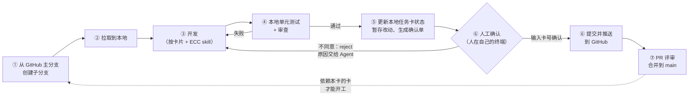

# 开发流程

每张任务卡都按同一个流程执行，由 `tools/task.py` 串起来。Agent 执行 ①~⑤，**提交与推送前必须由人确认（⑥）**。Agent 和人都用这套命令，不要手工拼 git 操作。

## 1. 一张卡的完整流程



| 步骤 | 执行者 | 命令 | 脚本做了什么 | 前置检查（不满足就停下） |
|---|---|---|---|---|
| ①② | Agent | `python tools/task.py start P1-03` | `git fetch`；在 GitHub 上从 `origin/main` 创建分支 `feature/p1-03-change-minimiser`（`git push origin origin/main:refs/heads/<分支>`）；拉取并切换到该分支；启用仓库自带的 Git 钩子（`core.hooksPath=.githooks`）；本地卡片状态改为 `in_progress`；打印本卡要用的 ECC skill，并提示缺失项 | 工作区干净；卡片在**主分支**上为 `todo`；全部依赖在**主分支**上为 `done`；远程分支不存在（继续之前的工作用 `--resume`） |
| ③ | Agent | — | 按卡片「产出」开发，按「ECC 技能」加载 skill | — |
| ④ | Agent | `python tools/task.py test P1-03`，然后调用审查 agent | 依次执行卡片「验收」中的命令 → 按工作项类型执行全量检查（Java：`./mvnw -q verify`；Web：`pnpm --filter wp-web run verify`；移动端：`pnpm --filter wp-mobile run verify`）→ 校验任务卡；结果和代码指纹写入 `.task-runs/P1-03.json`。审查后有改动必须重新 `test` | 当前分支就是本卡的分支 |
| ⑤ | Agent | `python tools/task.py finish P1-03 -m "feat(kernel): port change list minimiser" --summary "…" --reviews "java-reviewer"` | 校验提交信息；自动勾选“验收命令全部通过”“全量检查通过”“执行记录已填写”；追加执行记录；状态改为 `done`；校验任务卡；`git add -A`；记录暂存树；生成**提交前确认单** `.task-runs/P1-03.review.md`。**不提交。** Agent 在对话里报告确认单要点后停止 | 最近一次测试**通过**，并且测试之后代码没有再改动；除“人已…”外的完成判据已由 Agent 勾选；提交信息符合规范且不含尾注 |
| ⑥ 人工确认 | **人** | `python tools/task.py commit P1-03`（可加 `--pr`、`--no-push`） | 显示确认单；`d` 查看完整改动；**输入卡号**后勾选“人已…”判据，`git commit`（自动加 `Task: P1-03` 与 `Confirmed-by: <你的 git 用户名与邮箱>` 尾注），`git push`；`--pr` 时用 `gh` 创建 PR；输入 `n` 并写原因等同 `reject` | 必须在交互式终端中运行；暂存区与准备时一致；暂存区以外没有改动或未跟踪文件；已设置 `git config user.name / user.email` |
| ⑥ 不同意 | 人 | `python tools/task.py reject P1-03 --reason "…"`（或在对话里告诉 Agent，由 Agent 运行） | 取消暂存，卡片恢复为准备前的内容（代码改动保留），原因写入 `.task-runs/P1-03.feedback.md`；Agent 读取后修改，重新 `test` → `finish` | 存在待确认的准备 |
| ⑦ | 人 | GitHub 网页、`gh pr create`、ECC 的 `/pr`，或 `commit --pr` | 发起 PR；CI 通过、评审通过后合并到 `main` | CI 绿灯（含提交尾注检查）；评审没有未解决的阻塞意见 |

### 关于人工确认（第 ⑥ 步）

确认点放在“提交”之前而不是 PR 阶段，是为了让**进入 GitHub 的每一个提交都经过人看过**：Agent 可以随意改本地文件，但写入 Git 历史和远程仓库只能由人触发。

确认时看什么：确认单中列出了提交信息、Agent 的改动说明与偏差、测试记录、已运行的审查 agent、改动文件统计，以及脚本自动发现的风险：

- 改动量超过卡片尺寸的预期（S ≤ 200 行、M ≤ 400 行，不含测试与测试数据）；
- 改动了卡片模块以外的目录；
- 改动了 ADR、`.cursor/rules`、skill、钩子、`tools/`、`.github/`；
- 改动了 `pom.xml` / `package.json` 等依赖声明；
- 卡片要求的审查 agent 没有在 `--reviews` 中列出。

这些是提示，不是拒绝条件，由人判断。确认单末尾有一份核对清单，与 `git-naming-conventions` skill 第 4 节相同。

确认之后又改了文件怎么办：`commit` 会比对暂存树，并拒绝暂存区以外的改动或未跟踪文件，提示让 Agent 重新 `test` 与 `finish`（重复 `finish` 会自动撤回上一次准备）。

这些检查由几层机制共同执行：

| 层 | 文件 | 作用 |
|---|---|---|
| Cursor 钩子 | `.cursor/hooks.json` → `.cursor/hooks/commit_gate.py` | Agent 执行 `git commit` / `push` / `merge` / `rebase` / `reset --hard`、`task.py commit`、`gh pr merge` 等命令时直接拒绝，并提示它停下来请人确认 |
| `task.py commit` | `tools/task.py` | 只能在交互式终端运行，必须由人输入卡号 |
| Git 钩子 | `.githooks/commit-msg`、`.githooks/pre-push` | 任务分支上缺少 `Task` / `Confirmed-by` 尾注的提交被拒绝；禁止直接推送 `main` |
| CI | P0-05 | PR 上每个提交都必须带两个尾注 |
| GitHub 分支保护 | 仓库设置 | `main` 只能经 PR 合并 |

需要说明的是：这些措施防的是**误操作和跳步**，不能防止有意绕过（例如 Agent 写脚本间接调用 git、人用 `--no-verify`）。最终防线是 GitHub 分支保护加 CI，以及人在合并 PR 前的评审。

### 关于第 ⑦ 步

你给出的流程到“推送到 GitHub”为止。这里补上第 ⑦ 步，因为每张新卡都从 `main` 拉分支：**上一张卡不合并到 `main`，依赖它的下一张卡就拿不到它的代码**。`start` 会检查依赖在 `main` 上的状态，未合并时直接拒绝开工。

没有依赖关系的卡（例如 P1 内核与 P2 迁移工具）可以各自开分支并行，不必等对方合并。

### 卡在中途怎么办

| 情况 | 做法 |
|---|---|
| 卡片有歧义、需要越界改动、改动量超标 | Agent 运行 `python tools/task.py block P1-03 --reason "…"`：本地状态改为 `blocked`，暂存当前进度并生成确认单，然后告诉人；人运行 `task.py commit P1-03` 后才提交并推送 |
| 测试失败 | 修复后重新 `test`；构建或依赖问题按卡片「ECC 技能」调用 build resolver（`java-build-resolver` / `build-error-resolver`）或 `/build-fix` |
| 人不同意提交 | `reject` 后，Agent 读 `.task-runs/<卡号>.feedback.md`，修改 → `test` → `finish` |
| Agent 被 Cursor 钩子拒绝 | 正常现象：说明它试图自己提交或推送。让它运行 `finish` 并报告，然后由你运行 `commit` |
| 想知道下一张做什么 | `python tools/task.py next`：按 `main` 上的真实状态列出可以开工的卡 |
| 想知道当前进度 | `python tools/task.py status`：测试记录是否有效、是否有待确认的提交、是否有未处理的反馈 |
| 换了电脑或会话中断 | `python tools/task.py start P1-03 --resume`。注意：确认之前代码只在本地，没有推送 |

## 2. 版本管理与团队协作

本目录的全部内容（规划、任务卡、任务索引与依赖图、规则、skill、钩子、流程脚本）都纳入 Git，托管在 GitHub 的 `guofengxu/webprotege-rebuild` 仓库。标准的修改同样走 PR（见 `CONTRIBUTING.md` 第 4 节）。

> **当前阶段：单人维护。** 分支保护使用单人配置（见下）；“多人并行的规则”、`CODEOWNERS` 评审与多人分支保护配置（`branch-protection.team.json`）暂不启用，待项目具备多人维护条件后重新规划。

### 维护者首次建仓（一次）

```bash
python tools/repo_setup.py init --gh-create guofengxu/webprotege-rebuild   # 或 --remote <已建好的空仓库地址>
python tools/repo_setup.py protect
```

- `init`：删除规划改版留下的空壳文件（内容只有 `<!-- superseded… -->`）→ 从 `tools/repo-templates/github/` 生成 `.github/`（PR 模板、`CODEOWNERS`、`branch-protection.json`；建仓后以 `.github/` 为准）→ `git init -b main` → 暂存全部文件并给钩子脚本加可执行位 → 基线提交 → 用 `gh` 在 GitHub 上建仓（默认私有）→ 推送 `main` → 启用 `.githooks`。只能在交互式终端运行，Cursor 钩子也会拒绝 Agent 执行。
- `protect`：按 `.github/branch-protection.json`（单人维护配置）设置 `main` 的分支保护：`main` 只能经 PR 合并、**管理员也不例外**（禁止直接推送）、禁止强推与删除、PR 上的评论必须全部解决；不要求批准人数和代码负责人评审，因为单人维护时没有第二个人能批准（PR 作者不能批准自己的 PR）。人工确认环节（`task.py commit`）仍然保留，相当于每个提交都由你本人审过。P0-05 合并后，把 CI 任务名加入 `required_status_checks` 并重新运行 `protect`。
- 多人协作时改用 `python tools/repo_setup.py protect --team`（`.github/branch-protection.team.json`：至少 1 人批准、标准文件需 `CODEOWNERS` 中的维护者批准）。GitHub 免费账户只有公开仓库支持分支保护。
- 然后在仓库设置中邀请同事，把 `CONTRIBUTING.md` 发给他们；按其第 5 节把 ECC 安装进仓库并提交。

### 每位开发者（一次）

克隆仓库（旧工程放在同级目录 `../webprotege`），运行 `python tools/repo_setup.py dev`，重启 Cursor。详见 `CONTRIBUTING.md` 第 1 节。

### 多人并行的规则（暂缓，待重新规划）

以下是已实现、但当前阶段不依赖的机制，供将来规划多人协作时参考：

| 问题 | 处理 |
|---|---|
| 两人想做同一张卡 | `start` 在 GitHub 上新建本卡分支即为认领；分支已存在时拒绝（同时认领时只有一人能新建成功）。`next` 只列出未被认领的卡，并单独列出已被认领的卡 |
| 依赖同事未合并的卡 | `start` 拒绝开工；先评审、合并对方的 PR |
| 谁确认的提交 | 每个提交的 `Confirmed-by` 尾注记录确认人（取其 `git config user.name / user.email`） |
| 合并冲突 | 任务卡单模块、文件路径写到类一级，冲突应很少。`tasks/INDEX.md` 与依赖图冲突时不要手工合并，运行 `python tools/plan_lint.py` 重新生成即可。冲突时由人在本卡分支上 `git merge origin/main` 解决（Agent 不执行 merge），然后重新 `test`、`finish`、`commit` |
| PR 评审 | 任意一位同事批准；标准文件需维护者批准。PR 模板见 `.github/pull_request_template.md` |

## 3. 约定

- 分支名：`<类型>/<卡号小写>-<卡片文件名中的短描述>`，由 `task.py` 生成，不要手工起名。规划卡用 `docs/`，CI 类用 `chore/`，其余用 `feature/`。规则见 `git-naming-conventions` skill 第 2 节。
- 提交信息：Conventional Commits，格式、scope 与尾注见 `.cursor/skills/git-naming-conventions/SKILL.md`。一张卡一个提交，由人运行 `task.py commit` 生成；Agent 不做中间提交。
- `.task-runs/` 中的文件：`<卡号>.json` 测试记录、`<卡号>.pending.json` 待确认的准备、`<卡号>.review.md` 确认单、`<卡号>.feedback.md` 人工反馈、`<卡号>.log.jsonl` 准备 / 确认 / 拒绝的历史。
- `tasks/INDEX.md` 与 `docs/03-plan/dependency-graph.md` 由 `plan_lint.py` 根据卡片生成，**纳入 Git**，不要手工编辑。`finish` 与 `block` 会重新生成它们，与卡片状态一起进入同一个提交；`reject` 撤回时也会重新生成。CI（P0-05）用 `plan_lint.py --check --check-index` 检查它们与卡片一致。多人并行后若频繁冲突，再重新评估是否入库。
- `.task-runs/` 只保存在本地，不纳入 Git。
- 主分支名默认为 `main`，远程默认为 `origin`；如有不同，设置环境变量 `WP_MAIN_BRANCH`、`WP_REMOTE`。
